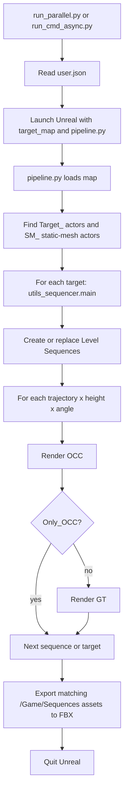

# MatrixCityPlugin Data Generation Pipeline

This document describes the behavior implemented by the current plugin code. It
is intentionally separate from the historical City Sample GUI tutorials. For
known reliability gaps, see [Synthetic Pipeline Audit](SYNTHETIC_PIPELINE_AUDIT.md).

## Scope and prerequisites

The pipeline automates one or more Unreal maps. Before launching it, each map
must satisfy these scene conventions:

| Item | Current convention |
| --- | --- |
| Map asset | `/Game/Map/<map_name>` |
| Target actor | Actor label begins with `Target_` |
| Occluder | `StaticMeshActor` label begins with `SM_` |
| Camera | Label from `misc/user.json`, default `CineCameraActor1` |
| Sequence assets | `/Game/Sequences/<trajectory_type>/` |

The target and occluder prefixes are currently hard-coded by `pipeline.py`.
`Batch_Settings` in the render YAML is descriptive only; changing it does not
change actor selection.

## Configuration ownership

| File or argument | Consumed by | Effective behavior |
| --- | --- | --- |
| `misc/user.json` | `run_cmd_async.py`, `run_parallel.py` | Defines the editor command, project, map, external Python entry point, and the requested render-config path. |
| `-target_map` | `pipeline.py` | Chooses the map; if omitted, the currently loaded map is used. |
| `misc/render_SAI_config.yaml` | `pipeline.py` | The effective render configuration for the current batch path. `pipeline.py` currently overrides the command-line render-config path with this file. |
| `misc/trajectory_config.yaml` | `utils_sequencer.py` | Defines trajectory types, camera heights (cm), azimuth angles, frame count, sequence FPS, and the camera label. |

Do not assume that changing `user.json.render_config` changes the render run.
Until `pipeline.py` is changed, update `render_SAI_config.yaml` for the active
batch pipeline and record that file with the produced data.

## Entry points

Run commands from the Unreal project root so relative paths in `user.json` are
resolved consistently.

```bash
# One map or the map already set in misc/user.json.
python Plugins/MatrixCityPlugin/misc/run_cmd_async.py \
  --config_file Plugins/MatrixCityPlugin/misc/user.json

# Partition maps across GPUs. The map list comes from --maps, user.json.maps,
# or Content/Map/scene_*.umap in that order.
python Plugins/MatrixCityPlugin/misc/run_parallel.py \
  --config Plugins/MatrixCityPlugin/misc/user.json \
  --num_gpus 1 --maps scene_010

# Export existing Level Sequences to FBX without rendering new images.
python Plugins/MatrixCityPlugin/misc/run_export_only.py \
  --config_file Plugins/MatrixCityPlugin/misc/user.json \
  --maps scene_010
```

`run_parallel.py` creates a temporary `ue_map` config per worker and invokes
`run_cmd_async.py`. The launcher starts Unreal with `-ExecCmds="py .../pipeline.py"`
and starts a local progress socket.

## Execution flow



### 1. Map and actor discovery

`pipeline.py` loads `-target_map` when one is supplied, then gathers all actor
labels beginning with `Target_` and all static mesh actor labels beginning with
`SM_`. Targets are sorted by label. It gives both sets to
`CustomMoviePipeline.start_batch_target_rendering`.

### 2. Sequence generation

For each target, `utils_sequencer.main` expands the Cartesian product of
`trajectory_types`, `camera_heights`, and `plane_angles` from
`trajectory_config.yaml`. Each generated Level Sequence is saved under:

```text
/Game/Sequences/<trajectory_type>/
```

Sequence names include the map, target, height in metres, and azimuth, for
example:

```text
scene_010_Target_003_height_050_ang_120
```

The generator binds the named scene camera as a possessable camera. If that
camera is missing, generation of that combination fails. Existing assets with
the same sequence path may be replaced by the generator, so a rerun is not an
immutable dataset version.

### 3. OCC and GT rendering

`CustomMoviePipeline.render_multi_trajectory_multi_height_serial` serializes
the generated sequences through the Movie Render Queue.

* **OCC**: only the current target remains visible among target actors; `SM_`
  occluders remain visible.
* **GT**: only the current target remains visible among target actors; `SM_`
  occluders are hidden.

`Only_OCC: true` in the active render YAML suppresses the GT step. Render pass
selection, resolution, anti-aliasing, output root, and the optional single-frame
mode are also controlled by `render_SAI_config.yaml`.

With the shipped filename template, the output tree is:

```text
<Output_Path>/
  <trajectory_type>/
    <map>_<target>_height_<metres>_ang_<degrees>_{occ|GT}/
      <render_pass>/
        <frame_number>.<extension>
```

The default active passes are `rgb` (PNG) and `depth` (EXR). Do not infer depth
units or channel semantics from the filename alone; the depth material is a UE
asset and requires calibration for geometry-sensitive use.

### 4. FBX export and downstream poses

After all targets for a map finish, the plugin calls
`export_sequences_for_map(map_name)`. It searches `/Game/Sequences` for
Level Sequence asset names containing the map name and exports them to:

```text
<ProjectDir>/Exported_FBX/<trajectory_type>/<sequence_name>.fbx
```

The plugin does **not** produce `transforms.json` or validate that RGB, EXR,
FBX, and camera poses correspond to the same frames. Any Blender pose extraction
and dataset packing is a separate downstream step and must retain explicit frame
identity and run metadata.

## Operational limits in the current implementation

These are current behaviors, not guarantees:

* `pipeline.py` connects its progress socket to port `9999`. Workers assigned
  another port by `run_parallel.py` are therefore not reliably isolated.
* A `Pipeline Finished` socket message means the code reached the map-complete
  branch; it is not a manifest-based validation of every expected output file.
* If a target fails to generate trajectories, the current batch path logs the
  failure and does not advance to a structured failed-run result.
* FBX export filters by map name across all `/Game/Sequences` assets, so stale
  sequences with matching names can be included.

Use a single worker, a dedicated output directory, and a small map/target smoke
test before a large run. The audit document records the code evidence and
recommended remediation for these limits.

## Related implementation files

* `misc/run_parallel.py` - multi-process map scheduler.
* `misc/run_cmd_async.py` - one Unreal process plus local socket monitor.
* `Content/Python/pipeline.py` - UE-side map, actor, and batch entry point.
* `Content/Python/utils_sequencer.py` - trajectory and Level Sequence creation.
* `Content/Python/custom_movie_pipeline.py` - OCC/GT visibility and MRQ queue.
* `Content/Python/export_sequences_to_fbx.py` - automatic FBX export.
