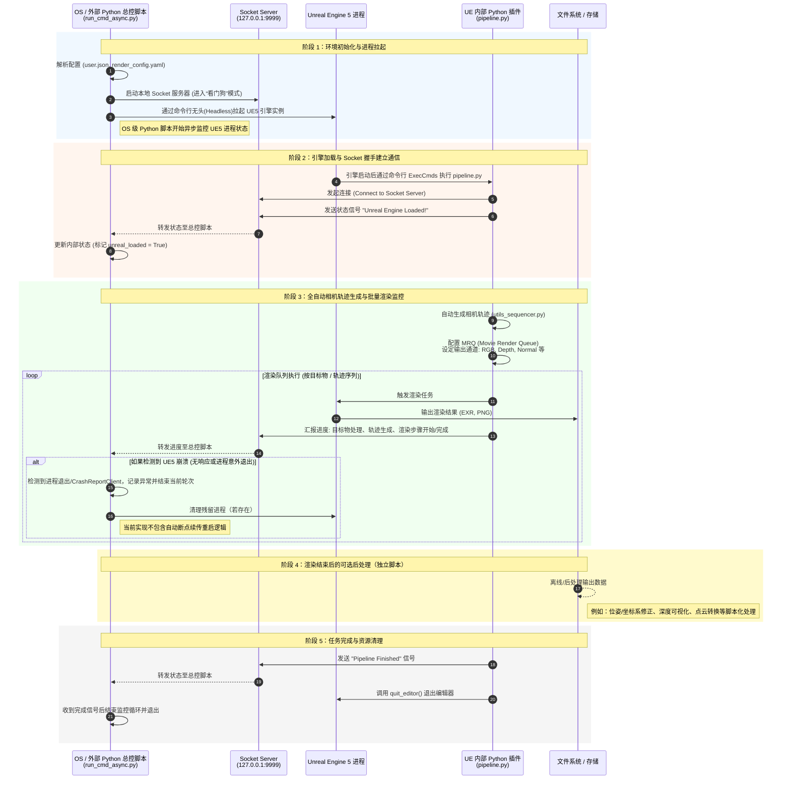
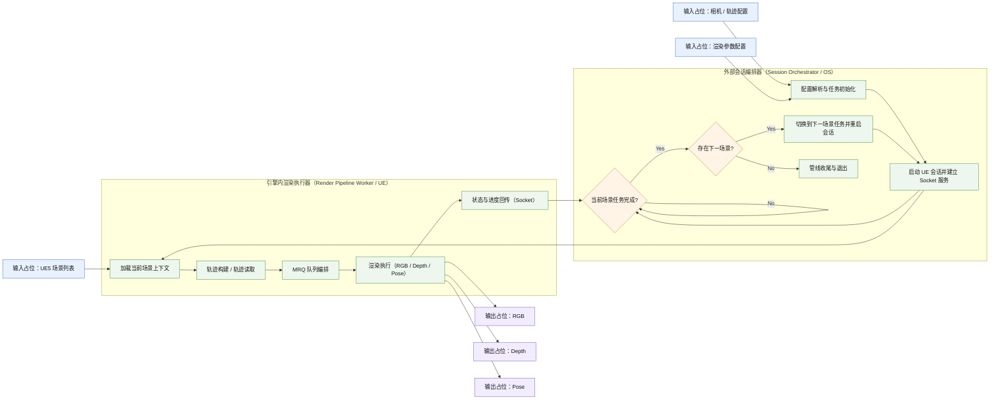

# UE5 自动化合成数据渲染管线架构图

这份文档展示了基于自定义 `MatrixCityPlugin` 插件的 UE5 自动化多模态数据生成管线架构。当前实现采用**双进程架构**，并通过 **Socket 进行进程间通信 (IPC)**，用于状态同步、进度日志传递和任务收尾控制。

---

## 核心架构流程图

下面的 Mermaid 序列图展示了整个工作流的详细交互，重点突出了 OS 层面的控制脚本与 UE5 内部执行环境之间的职责分离，以及关键的 Socket 通信机制。

---

## PPT / 论文风格流程图（专业简化版）

下面这张图用于展示方法主干：输入定义、管线编排、场景迭代与多模态输出，适合直接用于答辩或论文方法页。

---

## PPT 演讲重点提炼：为什么要用 Socket 通信？

在向面试官展示这个流程图时，重点强调**双进程架构与 Socket 通信带来的工程价值**（按当前实现表述）：

1. **解耦与稳定性 (Decoupling & Robustness):**
    *   外部脚本 `run_cmd_async.py` 独立负责进程拉起、Socket 服务和日志监控，渲染逻辑保持在 UE 内部 Python 侧。
    *   当 UE 进程异常退出时，外部脚本可检测并结束当前任务，避免控制逻辑与引擎生命周期强耦合。

2. **实时状态感知 (Real-time State Monitoring):**
   *   两个进程之间如何对话？**Socket 就是它们的桥梁**。
    *   UE5 内部 `pipeline.py` / `custom_movie_pipeline.py` 会通过 Socket 上报关键状态（引擎加载完成、目标物处理进度、渲染开始/完成、管线结束）。
    *   外部脚本据此做状态判定与日志聚合；当前版本已实现异常检测与进程清理，但未实现自动断点续渲。

3. **数据后处理层（按代码实情）：**
    *   渲染结果可在 `scripts/` 中通过离线脚本进行坐标系修正、深度可视化、点云转换等处理；这部分不在主渲染管线内自动执行。